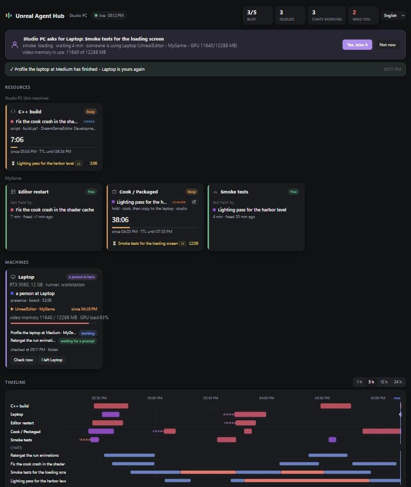
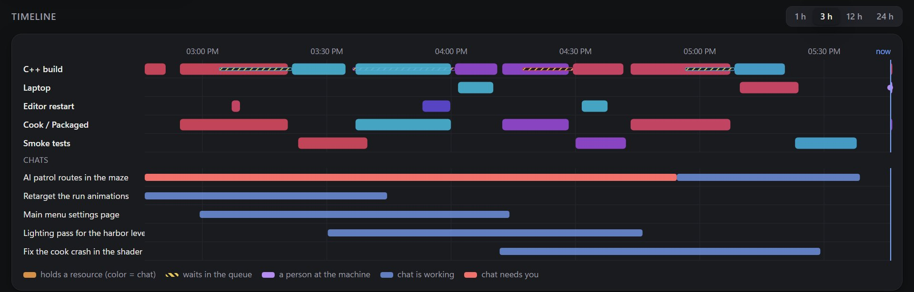
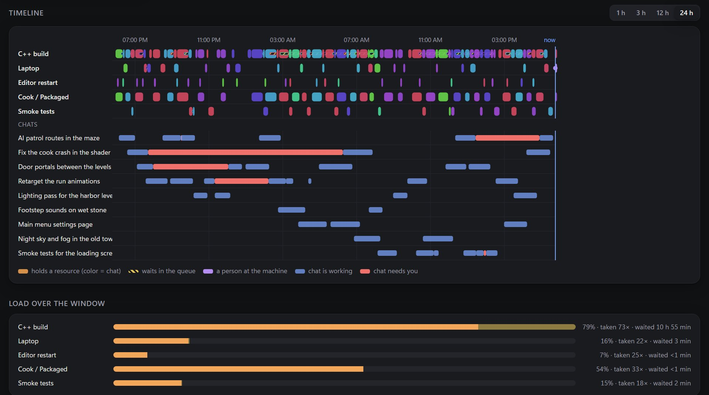
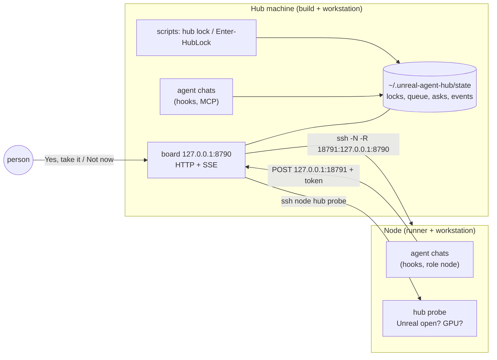

# Unreal Agent Hub

**Several AI coding agents - Claude Code, OpenAI Codex, Cursor - and your own build scripts share one Unreal
editor, one C++ build, one cook and a GPU laptop. Unreal Agent Hub is the queue between them:** a heavy launch
waits its turn by itself, everyone sees who holds what on a live board, and a machine that a person is sitting
at is never taken from them - a remote run asks first ("Yes, take it" / "Not now"). It works for one machine or
many (a hub plus nodes over ssh), with no daemons on the nodes and no model turns spent on waiting: advisory
resource locks with priorities, a job queue, presence, hooks, an MCP server and a dashboard for multi-agent
game development (Unreal Engine 5, later Blender).



### License: free for individuals and small studios

Unreal Agent Hub is source-available under the [PolyForm Small Business License 1.0.0](LICENSE). It is free to
use, change and run for everyone below the size line, commercial work included; larger companies buy a license.

| Can I use it? | |
|---|---|
| Individual, hobby, study, non-commercial project | **Yes, free** |
| Studio or company with fewer than 100 people **and** under ~1M USD revenue last year | **Yes, free** - including for commercial games |
| Larger studio or company | **Needs a license** - [contact us](COMMERCIAL.md) |

- **Does the license touch my game?** No. The hub is a development tool; it does not ship inside your game, and the
  license has no claim on what you make with it.
- **I am a freelancer working for a big studio.** The license follows the company you work for: the studio needs
  the license, not you personally.
- **Why this model?** Like Unreal Engine's "free until you earn 1M USD": small teams pay nothing, large companies
  that get real value pay a fair price. Unsure whether you qualify? [Ask](COMMERCIAL.md) - that is the point.

## Why

Two chats rebuild C++ at the same time and both fail on locked files. One chat restarts the editor while another
one drives it over MCP. A smoke test is copied to the laptop you are using right now and steals its GPU. The
usual fixes - "tell each chat to check first", a lock file nobody cleans up, messages between chats - cost model
turns and still race. The hub makes the scripts and hooks wait, like `flock(1)` or a CI concurrency group, and
shows the queue.

## Features

- **Locks that wait by themselves.** `hub lock cpp -- build.bat` waits its turn, runs, releases. Hooks make an
  agent's heavy tool calls (Unreal editor, UnrealBuildTool, RunUAT, `mcp__unreal-mcp__*`) wait the same way;
  after a timeout the call is denied with the holder's name, never forced through.
- **One chat per shared file.** The first chat that edits a shared file (C++ sources, configs, your scripts) holds
  it until its change is committed or merged into main; another chat's edit is refused with the holder's name.
  Edits of what the build compiles wait while another chat builds or packages ([FILES](docs/FILES.md)).
- **Editor restarts that don't break the other chats.** While one chat restarts the editor (its MCP server), the
  other chats' MCP calls wait instead of hitting a dead port; an editor a chat closed or that crashed is opened again
  by the board, never during a build and never after a person closed it ([WATCH](docs/WATCH.md)).
- **One protocol, any language.** Plain JSON files in `~/.unreal-agent-hub/state`, atomic create and
  rename-aside break, no mutex ([PROTOCOL](docs/PROTOCOL.md)). Node CLI, PowerShell module, MCP tools - all equal.
- **Priorities without preemption.** A person at the machine > a chat on that machine > a chat's hold > scripts;
  waiting ages a request upwards so nobody starves. Nobody is ever pushed out of a lock ([ROLES](docs/ROLES.md)).
- **Machine roles.** `build`, `workstation`, `runner`, `hub`; ask for `role:runner` and get the first free runner.
- **Presence and handover.** "I am at this laptop" (board button, `hub here`, MCP) or simply an open Unreal on its
  desktop: remote runs queue and **ask**. You answer on the board or in any chat; when the run ends the machine
  comes back by itself with a "the machine is yours again" notice ([HANDOVER](docs/HANDOVER.md)).
- **Load detector.** A workstation whose GPU memory or CPU is eaten by other apps counts as busy.
- **Claude Code, Codex and Cursor.** One hook command for all three, with each agent's payload and answer format
  ([AGENTS](docs/AGENTS.md)); a Claude Code plugin with its own marketplace; `hub install-hooks --agent ...`.
- **MCP server.** `hub_status`, `hub_hold`, `hub_release`, `hub_here`, `hub_grant`, `hub_decline` ([MCP](docs/MCP.md)).
- **Live board.** Resources with holders, timers and queues, machines with probes, a 24 h timeline, load, chats with
  their agent and their background work, subagents and cloud sessions of Claude Code chats, charts, in English, German, French, Italian, Spanish and Russian ([BOARD](docs/BOARD.md)).
- **Many machines, nothing to install as a service.** The hub opens a reverse ssh tunnel to each node; the node's
  hooks talk to `127.0.0.1` there. Direct HTTP and a synced folder are alternatives ([TRANSPORTS](docs/TRANSPORTS.md)).
- **Safe by default.** Board on 127.0.0.1 with Host and Origin checks, node tokens, fixed ssh commands, hooks that
  fail open, nothing that stops processes ([SECURITY](docs/SECURITY.md)).
- **No dependencies.** Node.js >= 18, nothing from npm at runtime; the board page is a prebuilt React + Mantine bundle
  (sources in `web-src/`, licenses of the bundled MIT/ISC/BSD libraries in `web/THIRD-PARTY-LICENSES.txt`).

### A busy day on the board

Nine chats share one build machine and a laptop. Every task runs the same pipeline: C++ build, cook (which keeps
holding the build), smoke test on the laptop. One colour is one chat; hatched bars are a stage waiting its turn.





Made-up data from `node examples/demo.cjs` (open `http://127.0.0.1:8791/?win=24`).

## How it works



A resource is a named exclusive lock with a TTL: a thing on the hub (`cpp`, a project's `editor`) or a whole
machine (`laptop`). The holder is a script (alive while its pid lives), a chat's hold (while the agent runs), a
node chat, or a person's presence. Details: [ARCHITECTURE](docs/ARCHITECTURE.md).

## Quick start

### One machine

```bash
npm i -g unreal-agent-hub            # or: git clone ... && node bin/hub.cjs
hub serve                            # the board: http://127.0.0.1:8790 (hooks also start it on demand)
hub lock cpp -- build.bat MyGameEditor Win64 Development
hub status
```

Describe your resources once in `~/.unreal-agent-hub/config.json`:

```json
{ "id": "studio", "label": "Studio PC", "resources": [ { "id": "cpp", "ttlMin": 90, "label": "C++ build" } ] }
```

and per project in `.unreal-agent-hub.json` next to the `.uproject`:

```json
{ "project": "MyGame",
  "resources": [ { "id": "editor", "ttlMin": 30, "label": "Editor restart" }, { "id": "cook", "ttlMin": 180 } ],
  "gates": [ { "tools": "^mcp__unreal-mcp__", "resource": "editor", "mode": "wait" } ] }
```

PowerShell scripts: `Import-Module ps/AgentHub.psm1; $l = Enter-HubLock cook; try { ... } finally { Exit-HubLock $l }`
([POWERSHELL](docs/POWERSHELL.md)).

### Hub and a node (for example, a laptop that runs smoke tests)

1. On the hub: `hub node add laptop --ssh laptop --roles runner,workstation` - writes the node into the config
   and prints the node's config with its token.
2. On the laptop: install the hub (plugin or npm) and save the printed JSON as `~/.unreal-agent-hub/config.json`
   (`"role": "node"`).
3. Make sure `ssh laptop node .unreal-agent-hub/bin/hub.cjs probe` works from the hub (your ssh keys; the hub
   never creates or changes keys).
4. Restart `hub serve` on the hub: it opens the tunnel and shows the laptop under **Machines**.
5. Runs from the hub take the laptop with `hub lock @node:laptop -- ...` (or `role:runner`). If you sit at the
   laptop, they wait and ask you.

### Claude Code

```text
/plugin marketplace add BRANDAY/unreal-agent-hub
/plugin install unreal-agent-hub@unreal-agent-hub
```

The plugin brings the hooks, the MCP server, a skill and `/hub-status`, `/hub-hold`, `/hub-release`. Without the
plugin: `hub install-hooks --agent claude` (keeps a backup of `~/.claude/settings.json`).

### OpenAI Codex

`hub install-hooks --agent codex` writes `~/.codex/hooks.json`; open Codex and trust the hooks with `/hooks` (Codex
runs no new hook until you do). MCP: add `[mcp_servers.unreal-agent-hub]` to `~/.codex/config.toml` (the command
prints it). The repository also carries a Codex plugin manifest (`plugin.json`, `mcp.json`).

### Cursor

Cursor already runs hooks from `~/.claude/settings.json` (Settings > Agents > Third-Party Imports, on by default),
so the Claude Code setup covers it. On a machine without Claude Code: `hub install-hooks --agent cursor`
(`~/.cursor/hooks.json`). Add the MCP server in Cursor's MCP settings with `node ~/.unreal-agent-hub/bin/hub.cjs mcp`.

For every agent, paste [AGENTS.snippet.md](AGENTS.snippet.md) into the project's `AGENTS.md` / `CLAUDE.md`.

## Configuration

Three layers, merged: the machine (`~/.unreal-agent-hub/config.json`), the project (`.unreal-agent-hub.json`) and
the plugin options. Everything - resources, nodes, priorities, aging, presence TTL, handover, what a node may
share (`share.prompt`: `none`, `clip160`, `full`) - is in [CONFIG](docs/CONFIG.md); profiles that decide which
chats take part and which calls are heavy are in [PROFILES](docs/PROFILES.md); which files are shared and which
wait for the build, in [FILES](docs/FILES.md). Command line: [CLI](docs/CLI.md).

## FAQ

**Does it stop or kill anything?** No. It only makes new work wait. A live lock is removed only by
`hub break --force`, which you run yourself; the board removes only stale locks (dead holder or TTL over).

**What if the hub is down or a hook fails?** Hooks fail open: the chat works as if there were no hub. A lock is
help, not a point of failure.

**Does waiting cost tokens?** No. The hook or script waits; the model is not involved until the call goes through.

**How does it know a person is at a machine?** An explicit mark (board, `hub here`, `hub_here`), or the profile's
processes in a desktop session (an open Unreal), or load above the profile's thresholds - plus a short pause after
you close Unreal.

**Will a remote run take my machine while I am away from the keyboard?** Only if you said so. It waits and asks;
"Yes, take it" lets in that one run, and your presence mark comes back when it ends.

**Why not just a lock file in the repo?** Several worktrees and machines, stale files after crashes, a queue order
everyone agrees on, and people's presence - see [PROTOCOL](docs/PROTOCOL.md) and [MIGRATION](docs/MIGRATION.md).

**Is the board exposed to the network?** No, it listens on 127.0.0.1 and refuses unknown `Host` headers. Nodes reach
it through the ssh tunnel with a token.

**Blender?** The profile is an example today (`profiles/examples/blender.json`): renders and bakes wait for the GPU
shared with Unreal. Blender jobs as queued work are planned after the first version.

## Compared with

| | Queue | Other machines | People's presence | Agent hooks | Board |
|---|---|---|---|---|---|
| **Unreal Agent Hub** | priorities + aging | yes (ssh tunnel, HTTP, folder) | yes, with handover requests | Claude Code, Codex, Cursor | yes |
| claude-presence (MCP) | no (advisory locks) | no | no | Claude Code | no |
| Claude Coordination MCP | no (file locks, tasks) | no | no | Claude Code | no |
| Jenkins Lockable Resources | yes | yes (Jenkins agents) | no | no | Jenkins UI |
| HTCondor desktop policy | yes (cluster) | yes | yes (idle machines only) | no | no |
| `flock(1)` | wait only | no | no | no | no |

## Project status

Version 0.3.0, built and tested on Windows 11 with Node.js 24; macOS and Linux paths exist but are less tested.
Built and tested: the lock protocol (including two-process races), queue, handover, hooks for the three agents
with documented payloads, board, MCP, PowerShell module, the file gate (claims, merge detection, build wait). Not yet: on-demand probes over direct HTTP, the write side
of the folder transport, delivering notifications into a chat over Claude's messaging socket (they are queued),
verification of the Codex plugin manifest and of plugin hooks on a live install. See [CHANGELOG](CHANGELOG.md).

```bash
npm test     # node:test, no dependencies
```

## Contributing

Issues and pull requests are welcome; pull requests need the [Contributor License Agreement](CLA.md) (a checkbox in
the template). See [CONTRIBUTING.md](CONTRIBUTING.md). Security issues: privately, see
[docs/SECURITY.md](docs/SECURITY.md#reporting).

## License

[PolyForm Small Business License 1.0.0](LICENSE) - source-available, not OSI open source. Free for individuals,
non-commercial use and small companies (under 100 people and 1M USD revenue); everyone else needs a commercial
license: [COMMERCIAL.md](COMMERCIAL.md) - an issue or discussion labelled `commercial-license`, or
i.miranovich.se@gmail.com.

Unreal Agent Hub is an independent project. It is not affiliated with, endorsed or sponsored by Anthropic, OpenAI,
Anysphere (Cursor) or Epic Games. Claude Code, Codex, Cursor and Unreal Engine are named only as tools this
project works with; the names are trademarks of their owners.
